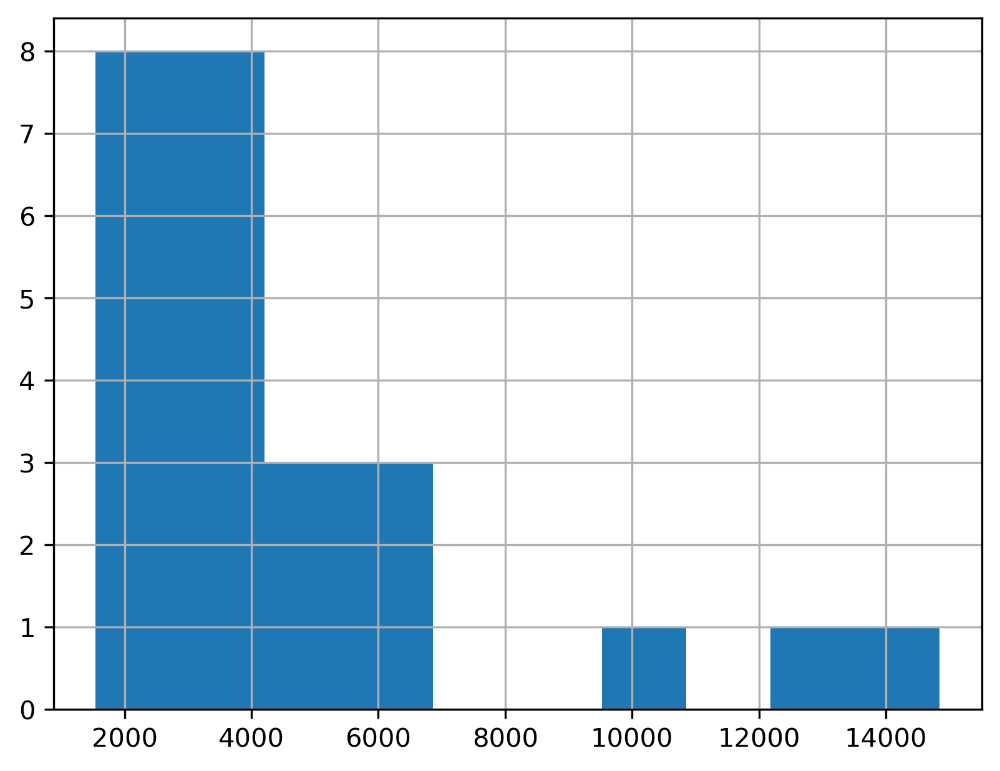
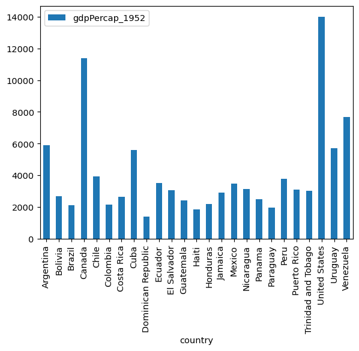
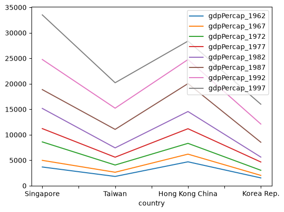
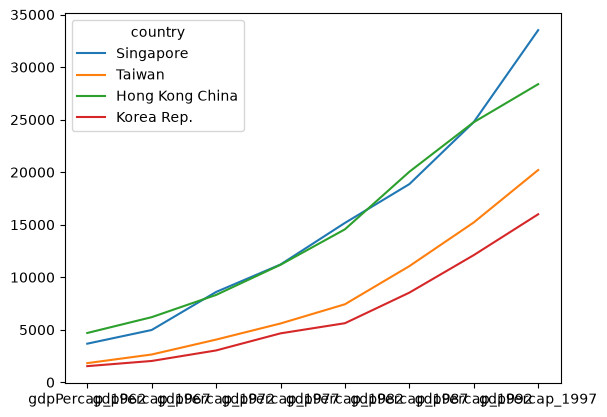
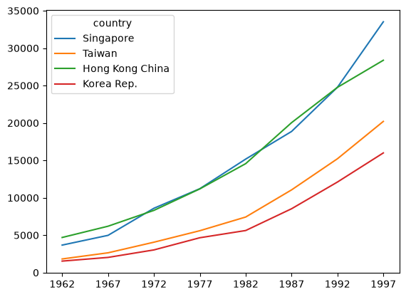
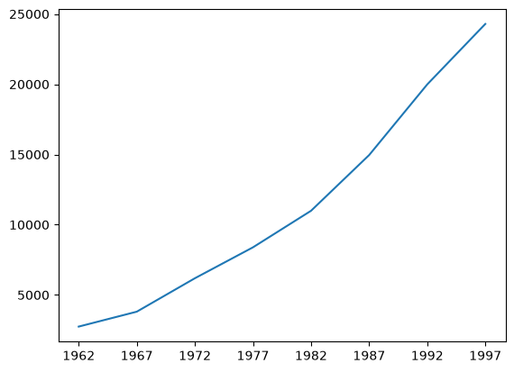
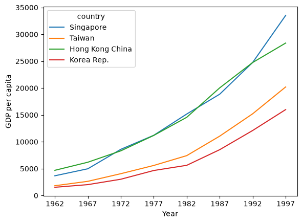
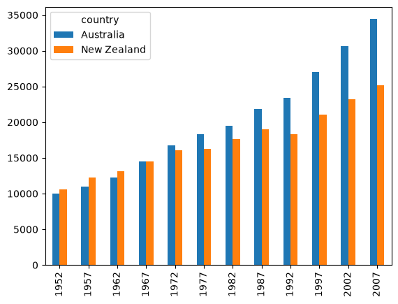
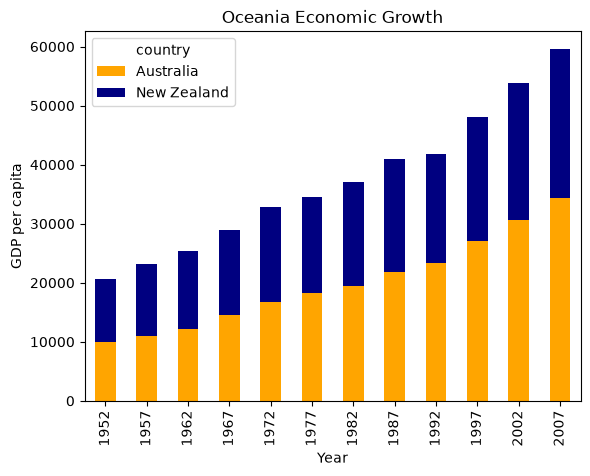

::::::::::::::::::::::::::::::::::::::: objectives

- Create a time series plot showing a single data set.
- Create a bar plot for a single data set.
- Customize plots with Matplotlib.

::::::::::::::::::::::::::::::::::::::::::::::::::

:::::::::::::::::::::::::::::::::::::::: questions

- How can I plot my data?
- How can I save my plot for publishing?

::::::::::::::::::::::::::::::::::::::::::::::::::

## [`matplotlib`](https://matplotlib.org/) is the most widely used scientific plotting library in Python.

We commonly use a sub-library called [`matplotlib.pyplot`](https://matplotlib.org/stable/tutorials/introductory/pyplot.html).

```python
import matplotlib.pyplot as plt
```

Let's create a simple plot with two lists, one for time on the x-axis and another for position on the y-axis.
```python
time = [0, 1, 2, 3]
position = [0, 100, 200, 300]

plt.plot(time, position)
plt.xlabel('Time (hr)')
plt.ylabel('Position (km)')
```

{alt='A line chart showing time (hr) relative to position (km), using the values provided in the code block above. By default, the plotted line is blue against a white background, and the axes have been scaled automatically to fit the range of the input data.'}

:::::::::::::::::::::::::::::::::::::::::  callout

## Display All Open Figures

In our Jupyter Notebook example, running the cell should generate the figure directly below the code.
The figure is also included in the Notebook document for future viewing.
However, other Python environments like an interactive Python session started from a terminal
or a Python script executed via the command line require an additional command to display the figure.

Instruct `matplotlib` to show a figure:

```python
plt.show()
```

This command can also be used within a Notebook - for instance, to display multiple figures
if several are created by a single cell.

::::::::::::::::::::::::::::::::::::::::::::::::::

## Plot data directly from a [`Pandas dataframe`](https://pandas.pydata.org/pandas-docs/stable/reference/api/pandas.DataFrame.html).

- You can also plot data directly from a DataFrame.
- Let's start with the `gdp_americas` CSV file.

```python
import pandas as pd
gdp_americas = pd.read_csv("data/gapminder_gdp_americas.csv")
```

- To plot a single, numeric variable you can
use [a histogram](https://pandas.pydata.org/docs/reference/api/pandas.Series.hist.html#pandas.Series.hist).
- We can plot the distribution of GDP in 1957 by using `.loc` to select the column followed by `.hist()`.

```python
gdp_americas.loc[:, "gdpPercap_1957"].hist()
```



- To plot two or more variables, you can use the built-in Pandas [bar chart](https://pandas.pydata.org/docs/reference/api/pandas.DataFrame.plot.bar.html) feature.

- For example, to plot the GDP of each country in `gdp_americas` in 1952 as a bar chart, assign "country" to the x-axis and `gdpPerCap_195` to the y-axis.

```python
gdp_americas.plot.bar(x="country", y="gdpPercap_1952")
```


## Plotting example: Tracing economic growth
Let's say you're only interested in studying the Four Asian Tigers: Hong Kong, Singapore, South Korea, and Taiwan. You want only those rows, and in that order. 

To start, let's read in a version of the `gdp_asia` data indexed by country. Then, we can use `.loc[]` with a list of rows: `["Singapore", "Taiwan", "Hong Kong China", "Korea Rep."]`.

Because these are post-war phenomena, you are only interested in these economies as they have evolved since 1962, so pass in the range `"gdpPercap_1962":"gdpPercap_1997"` to `.loc[]`.

```python
import pandas as pd
gdp_asia_country = pd.read_csv("../data/gapminder_gdp_asia.csv", index_col="country")
tigers = gdp_asia_country.loc[["Singapore", "Taiwan", "Hong Kong China",
                               "Korea Rep."], "gdpPercap_1962":"gdpPercap_1997"]
tigers
```
```output
	gdpPercap_1962 	gdpPercap_1967 	gdpPercap_1972 	gdpPercap_1977 	gdpPercap_1982 	gdpPercap_1987 	gdpPercap_1992 	gdpPercap_1997
country 								
Singapore 	3674.735572 	4977.418540 	8597.756202 	11210.089480 	15169.161120 	18861.530810 	24769.89120 	33519.47660
Taiwan 	1822.879028 	2643.858681 	4062.523897 	5596.519826 	7426.354774 	11054.561750 	15215.65790 	20206.82098
Hong Kong China 	4692.648272 	6197.962814 	8315.928145 	11186.141250 	14560.530510 	20038.472690 	24757.60301 	28377.63219
Korea Rep. 	1536.344387 	2029.228142 	3030.876650 	4657.221020 	5622.942464 	8533.088805 	12104.27872 	15993.52796
```

If we try the default parameters (no arguments passed) with `.plot()`, we get a graph that's not quite what we want. The x and y axes are reversed.

```python
tigers.plot()
```


We can address this by plotting the DataFrame using the `.T` attribute to flip the x and y axes of the `tigers` DataFrame.

```python
tigers.T.plot()
```


Now, we'll fix the axes. 
To adjust the column names, we'll apply a special [removeprefix](https://pandas.pydata.org/docs/reference/api/pandas.Series.str.removeprefix.html) method to remove the `gdpPercap_` prefix.


```python
tigers.columns = tigers.columns.str.removeprefix("gdpPercap_") 
tigers
```
```output

	1962 	1967 	1972 	1977 	1982 	1987 	1992 	1997
country 								
Singapore 	3674.735572 	4977.418540 	8597.756202 	11210.089480 	15169.161120 	18861.530810 	24769.89120 	33519.47660
Taiwan 	1822.879028 	2643.858681 	4062.523897 	5596.519826 	7426.354774 	11054.561750 	15215.65790 	20206.82098
Hong Kong China 	4692.648272 	6197.962814 	8315.928145 	11186.141250 	14560.530510 	20038.472690 	24757.60301 	28377.63219
Korea Rep. 	1536.344387 	2029.228142 	3030.876650 	4657.221020 	5622.942464 	8533.088805 	12104.27872 	15993.52796
```

Let's try plotting the transposed version of our modified DataFrame again.

```python
tigers.T.plot()
```


We can combine plotting with other statistic methods by chaining them together. For example, let's plot the median GDP per capita of the Four Tigers between 1952 and 1997.

```python
tigers.median().plot() # Example of "chaining"
```


## Customizing plots
We can use the `plt` module from `matplotlib` to customize the appearance of our plots.

We can use the `plt.xlabel()` and `plt.ylabel()` functions to label the x and y axes of our plots.

```python
import matplotlib.pyplot as plt
tigers.T.plot() # Example of "chaining"
plt.ylabel('GDP per capita')
plt.xlabel('Year')
plt.show()
```


We can also customize the color of our plot. Let's try a grouped bar chart comparing the GDP per-capita of New Zealand and Australia. 

This will require us to read in the `gapminder_gdp_oceania.csv` file and apply the same `.removeprefix()` we used before.

```python
gdp_oceania = pd.read_csv("data/gapminder_gdp_oceania.csv", 
                          index_col="country")
gdp_oceania.columns = gdp_oceania.columns.str.removeprefix("gdpPercap_")
```

Let's try plotting the `gdp_oceania` DataFrame with the default settings.

```python
gdp_oceania.T.plot.bar()
```


Let's add a title, axes, and color configuration options. Try turning the `stacked=` argument on and off to see what it does!

```python
gdp_oceania.T.plot.bar(color=["orange", "navy"], stacked=True)
plt.title("Oceania Economic Growth")
plt.ylabel('GDP per capita')
plt.xlabel('Year')
plt.show()
```



You can learn more about plotting configuration options in the [Pandas documentation](https://pandas.pydata.org/docs/reference/api/pandas.DataFrame.plot.bar.html) and the [Matplotlib documentation](https://matplotlib.org/3.5.3/api/_as_gen/matplotlib.pyplot.html).

:::::::::::::::::::::::::::::::::::::::  challenge

## Minima and Maxima

Fill in the blanks below to plot the minimum GDP per capita over time
for all the countries in Europe.
Modify it again to plot the maximum GDP per capita over time for Europe.

```python
data_europe = pd.read_csv('data/gapminder_gdp_europe.csv', index_col='country')
data_europe.____.plot(label='min')
data_europe.____
plt.legend(loc='best')
plt.xticks(rotation=90)
```

:::::::::::::::  solution

## Solution

```python
data_europe = pd.read_csv('data/gapminder_gdp_europe.csv', index_col='country')
data_europe.min().plot(label='min')
data_europe.max().plot(label='max')
plt.legend(loc='best')
plt.xticks(rotation=90)
```

{alt='Minima Maxima Solution'}


:::::::::::::::::::::::::

::::::::::::::::::::::::::::::::::::::::::::::::::

:::::::::::::::::::::::::::::::::::::::  challenge

## Correlations

Modify the example in the notes to create a scatter plot showing
the relationship between the minimum and maximum GDP per capita
among the countries in Asia for each year in the data set.
What relationship do you see (if any)?

:::::::::::::::  solution

## Solution

```python
data_asia = pd.read_csv('data/gapminder_gdp_asia.csv', index_col='country')
data_asia.describe().T.plot(kind='scatter', x='min', y='max')
```

{alt='Correlations Solution 1'}

No particular correlations can be seen between the minimum and maximum GDP values
year on year. It seems the fortunes of asian countries do not rise and fall together.


:::::::::::::::::::::::::

You might note that the variability in the maximum is much higher than
that of the minimum.  Take a look at the maximum and the max indexes:

```python
data_asia = pd.read_csv('data/gapminder_gdp_asia.csv', index_col='country')
data_asia.max().plot()
print(data_asia.idxmax())
print(data_asia.idxmin())
```

:::::::::::::::  solution

## Solution

{alt='Correlations Solution 2'}

Seems the variability in this value is due to a sharp drop after 1972.
Some geopolitics at play perhaps? Given the dominance of oil producing countries,
maybe the Brent crude index would make an interesting comparison?
Whilst Myanmar consistently has the lowest GDP, the highest GDP nation has varied
more notably.


:::::::::::::::::::::::::

::::::::::::::::::::::::::::::::::::::::::::::::::

:::::::::::::::::::::::::::::::::::::::  challenge

## More Correlations

This short program creates a plot showing
the correlation between GDP and life expectancy for 2007,
normalizing marker size by population:

```python
data_all = pd.read_csv('data/gapminder_all.csv', index_col='country')
data_all.plot(kind='scatter', x='gdpPercap_2007', y='lifeExp_2007',
              s=data_all['pop_2007']/1e6)
```

Using online help and other resources,
explain what each argument to `plot` does.

:::::::::::::::  solution

## Solution

{alt='More Correlations Solution'}

A good place to look is the documentation for the plot function -
help(data\_all.plot).

kind - As seen already this determines the kind of plot to be drawn.

x and y - A column name or index that determines what data will be
placed on the x and y axes of the plot

s - Details for this can be found in the documentation of plt.scatter.
A single number or one value for each data point. Determines the size
of the plotted points.


:::::::::::::::::::::::::

::::::::::::::::::::::::::::::::::::::::::::::::::

:::::::::::::::::::::::::::::::::::::::::  callout

## Saving your plot to a file

If you are satisfied with the plot you see you may want to save it to a file,
perhaps to include it in a publication. There is a function in the
matplotlib.pyplot module that accomplishes this:
[savefig](https://matplotlib.org/stable/api/_as_gen/matplotlib.pyplot.savefig.html).
Calling this function, e.g. with

```python
plt.savefig('my_figure.png')
```

will save the current figure to the file `my_figure.png`. The file format
will automatically be deduced from the file name extension (other formats
are pdf, ps, eps and svg).

Note that functions in `plt` refer to a global figure variable
and after a figure has been displayed to the screen (e.g. with `plt.show`)
matplotlib will make this  variable refer to a new empty figure.
Therefore, make sure you call `plt.savefig` before the plot is displayed to
the screen, otherwise you may find a file with an empty plot.

When using dataframes, data is often generated and plotted to screen in one line.
In addition to using `plt.savefig`, we can save a reference to the current figure
in a local variable (with `plt.gcf`) and call the `savefig` class method from
that variable to save the figure to file.

```python
data.plot(kind='bar')
fig = plt.gcf() # get current figure
fig.savefig('my_figure.png')
```

::::::::::::::::::::::::::::::::::::::::::::::::::

:::::::::::::::::::::::::::::::::::::::::  callout

## Making your plots accessible

Whenever you are generating plots to go into a paper or a presentation, there are a few things you can do to make sure that everyone can understand your plots.

- Always make sure your text is large enough to read. Use the `fontsize` parameter in `xlabel`, `ylabel`, `title`, and `legend`, and [`tick_params` with `labelsize`](https://matplotlib.org/stable/api/_as_gen/matplotlib.axes.Axes.tick_params.html) to increase the text size of the numbers on your axes.
- Similarly, you should make your graph elements easy to see. Use `s` to increase the size of your scatterplot markers and `linewidth` to increase the sizes of your plot lines.
- Using color (and nothing else) to distinguish between different plot elements will make your plots unreadable to anyone who is colorblind, or who happens to have a black-and-white office printer. For lines, the `linestyle` parameter lets you use different types of lines. For scatterplots, `marker` lets you change the shape of your points. If you're unsure about your colors, you can use [Coblis](https://www.color-blindness.com/coblis-color-blindness-simulator/) or [Color Oracle](https://colororacle.org/) to simulate what your plots would look like to those with colorblindness.
  

::::::::::::::::::::::::::::::::::::::::::::::::::

:::::::::::::::::::::::::::::::::::::::: keypoints

- [`matplotlib`](https://matplotlib.org/) is the most widely used scientific plotting library in Python.
- You can plot data directly from a Pandas dataframe using `.plot()`.
- Many styles of plot are available: see the [Python Graph Gallery](https://python-graph-gallery.com/matplotlib/) for more options.

::::::::::::::::::::::::::::::::::::::::::::::::::


